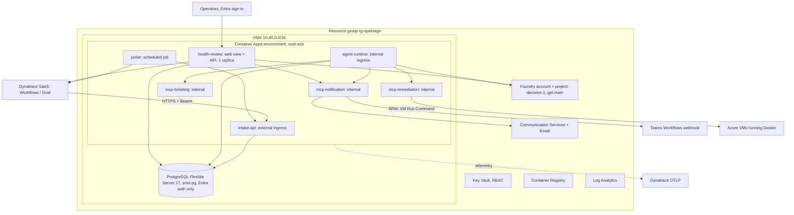

# Ops Triage Agents: Azure Deployment Specification

| Field | Value |
|---|---|
| Spec ID | OTA-AZ-001 |
| Version | 1.1 (2026-10-13) |
| Prepared by | Tim, Solution Architect |
| Audience | The platform team implementing the deployment (engineers or AI coding agents) and its reviewers |
| Depends on | OTA-APP-001, Application Specification (services, settings, contracts); OTA-APP-002, Kafka Health Review (health-review service); ADRs 0009 to 0012 |
| IaC | Terraform, `hashicorp/azurerm` 5.x and `azure/azapi` 2.x |
| Status | Application built (OTA-APP-001 and OTA-APP-002 Module 5). Infrastructure ready for implementation; phases 3 and 4 are blocked until the application prerequisites in Section 0.2 are done |

---

## 0. How to use this spec

1. Implement in the order of Section 13 (Deployment plan). Each phase has a Definition of Done.
2. HCL samples match the provider schemas as documented on 2026-10-12 (azurerm 5.9.0, azapi 2.13.0). If `terraform validate` disagrees, follow the provider docs, keep the intent, and record the change in `docs/adr/`.
3. Nothing in the application is Azure-specific except adapters selected by settings. This spec only supplies infrastructure and settings values.
4. Use `terraform fmt`, `terraform validate` and `tflint` in CI. Never run `apply` from a laptop against `prod`.

### 0.1 Changes in 1.1

- **Health review (OTA-APP-002) added** as a seventh app, `health-review`, with:
  - its own identity and database role;
  - Grail access;
  - its own settings (Section 9.2);
  - operations notes (Section 12).
- **Models in Azure decided (ADR 0012):**
  - **Triage decisions:** Kafka signatures first, then `Microsoft-Decision-1` (`TRIAGE__DECISION__PROVIDER=systemone`). This replaces Qwen, which ADR 0009 used locally.
  - **Health-review analyst:** the Foundry GPT deployment `gpt-main`, reached through the model-agnostic `llm` client (ADR 0010).
  - **Triage summarizer:** also `gpt-main`, once the Foundry summarizer exists.
- **Section 9 updated** for the settings added since 1.0:
  - the `llm` decision provider fields;
  - `TRIAGE__INSIGHTS_BASE_URL`;
  - `INSIGHTS__*`.
- **CI updated:** installs every workspace package, builds `health-review`, and smoke-tests it.
- **Section 0.2 added:** application prerequisites that the code does not yet meet.

### 0.2 Application prerequisites (block phases 3 and 4)

Found by checking the code against this spec on 2026-10-13. Each item is application work in this repository, not infrastructure.

**Status 2026-10-13: P1 to P7 are done.** They were delivered with the `PLATFORM` switch (ADR 0013), and the table below keeps the original findings for reference.
- **Adapters added:** the ACS email sender and the `azure_run_command` executor, which 1.0 assumed existed but did not.
- **Fix:** the triage inbox's LISTEN connection now uses managed identity too.
- **Still open:**
  - real entity IDs in `config/insights.<env>.yaml`;
  - real VM resource IDs in `config/targets.<env>.yaml`;
  - every Grail, ARM and ACS detail marked INFERRED in the adapters, to be confirmed in phases 3 to 5.

| # | Gap | Effect if deployed as is | Fix |
|---|---|---|---|
| P1 | No service installs the `entra` extras (`opstriage-shared[entra]`, `opstriage-llm[entra]`), so `azure-identity` and `azure-postgresql-auth` are missing from the images | Entra sign-in to PostgreSQL and Foundry fails at start-up | Depend on `opstriage-shared[entra]` (every service with a database) and `opstriage-llm[entra]` (agent-runtime, health-review); relock |
| P2 | `TRIAGE__CONTEXT__PROVIDER=grail` is refused by the settings validator ("not built in the local scope") | agent-runtime will not start | Build the Grail context adapter on `packages/dynatrace`, with a contract test |
| P3 | `TRIAGE__SUMMARIZER__PROVIDER=foundry` is refused ("arrives with the Azure deployment") | agent-runtime will not start | Build the Foundry summarizer on `packages/llm`, or deploy with `template` until it exists (Section 9.1) |
| P4 | `config/policy.dev.yaml`, `config/policy.prod.yaml` and `config/targets.prod.yaml` do not exist | `docker build --build-arg OPSTRIAGE_ENV=dev` fails for agent-runtime; prod builds fail for agent-runtime and mcp-remediation | Create them, starting from `policy.example.yaml`, which is calibrated for Decision-1 and Jev (Section 9.1) |
| P5 | The health-review image contains no `config/` (compose mounts it locally): no cluster list (`insights.<env>.yaml`) and no `insights-runbook.md` | health-review starts with no clusters and no analyst runbook | Bake `config/insights.${OPSTRIAGE_ENV}.yaml` and `config/insights-runbook.md`, as the other Dockerfiles do; create `insights.dev.yaml` and `insights.prod.yaml` with real entity IDs |
| P6 | `infra/db-bootstrap/` (program and Dockerfile) does not exist, but CI builds it and phase 3 depends on it | Phase 3 cannot complete | Add it per Section 8 |
| P7 | Images include `fixtures/` | Harmless when `INSIGHTS__SOURCE=grail` and `POLLER__SOURCE=grail`, but it is test data in production images | Optional: an `OPSTRIAGE_ENV` build stage that skips fixtures outside `example` |

---

## 1. Scope and assumptions

- Greenfield: a new resource group per environment (`dev`, `prod`) in an existing subscription and Entra tenant.
- Dynatrace is SaaS. The intake API must be reachable from Dynatrace over public HTTPS (or through EdgeConnect if the endpoint is private later).
- Models come from Microsoft Foundry (ADR 0012):
  - `Microsoft-Decision-1` for triage decisions, after the deterministic Kafka signatures;
  - one GPT deployment, `gpt-main`, for the health-review analyst and the optional triage summarizer.

  Nothing runs on the DGX Spark in Azure. Kev, Qwen and the DeBERTa guard are local only.
- Restart targets are Docker containers on VMs. Azure VMs are restarted through VM Run Command (control plane, no network path from Container Apps to the VMs is needed). On-premises VMs use Arc Run Command or SSH (Section 6.4).
- CI/CD runs on GitHub Actions with OIDC federation to Azure. No long-lived secrets in GitHub.

---

## 2. Hosting decision: top two options

The question was Azure Container Apps, AKS, or Azure Functions, optimized for **ease of deployment and maintenance**. The two real contenders are Container Apps and AKS. Functions and the other options are covered in 2.3.

### 2.1 Comparison

| Criterion | 1. Azure Container Apps (recommended) | 2. Azure Kubernetes Service |
|---|---|---|
| Fit for this workload | Microsoft's MCP hosting guide recommends Container Apps for "multiple MCP servers with service-to-service calls" and calls it the most flexible default | Recommended by the same guide when you already run AKS or need the Kubernetes API, GPU pools or service mesh |
| Operational overhead | Rated "Medium" (Dockerfile, registry); no cluster, node pools or upgrades to manage | Rated "High" (cluster management, upgrades, networking) |
| Service-to-service | Built in: `http://<app-name>` inside the environment, internal ingress | Kubernetes Services, Ingress controller you install and operate |
| Singleton poller | Scheduled Container Apps Job (cron, UTC, 1-minute granularity) or an app with 1 replica | CronJob or Deployment with leader election |
| Scale | Per-app replicas, HTTP and custom (KEDA) rules, scale to zero optional | HPA, KEDA, cluster autoscaler |
| Secrets and identity | Key Vault references per app, user-assigned managed identity per app | Workload Identity, CSI secret store driver |
| Terraform | First-class `azurerm_container_app`, `azurerm_container_app_job`, `azurerm_container_app_environment` | `azurerm_kubernetes_cluster` plus Helm or Kubernetes provider for workloads (two layers) |
| Cost model | Per vCPU-second and GiB-second on Consumption; dedicated workload profiles optional | VM nodes plus cluster fee whether busy or idle |
| Limits that matter here | 240-second ingress request timeout (handled in OTA-APP-001 by async remediation), no Docker socket (not needed) | None material |
| When it loses | You need Kubernetes APIs, many unrelated workloads in one cluster, or GPU nodes for self-hosted models | |

### 2.2 Decision

**Azure Container Apps**, in a VNet-integrated environment with a Consumption workload profile. It gives the lowest operational burden for seven small services plus scheduled jobs, all with managed identities, Key Vault references and first-class Terraform support. AKS is the documented fallback if the organization later mandates a shared AKS platform; Appendix A lists what changes.

### 2.3 Options considered and rejected

| Option | Why not (for v1) |
|---|---|
| Azure Functions (Flex Consumption, MCP extension) | Good for stateless tool endpoints, but splits the runtime model: a long-lived LangGraph worker with a checkpointer and an inbox loop fits poorly, and "everything runs in containers" is a requirement. |
| Foundry Agent Service hosted agents | Runs containerized LangGraph agents with per-session sandboxes and an agent identity. It does not suit the webhook intake, the poller or the MCP servers, the docs show no Terraform path, and sessions are idle-timeout based (2 to 60 minutes). Revisit later for the agent runtime only. |
| Azure App Service | Workable for the API and MCP servers, but no job primitive for the poller and weaker service-to-service networking than a Container Apps environment. |
| Container Apps Express | GA since October 2026, but no service discovery, Key Vault references, built-in auth, jobs, workload profiles or custom domains. |

---

## 3. Target architecture



### 3.1 Resource inventory and naming

Pattern: `<type>-opstriage-<env>-<region-short>`; globally unique names add a 4-character suffix from `random_string`.

| Resource | Example name | Notes |
|---|---|---|
| Resource group | `rg-opstriage-prod-eus2` | |
| Log Analytics | `log-opstriage-prod-eus2` | Container Apps logs destination |
| VNet and subnets | `vnet-opstriage-prod-eus2`; `snet-aca` /23, `snet-pg` /27, `snet-pe` /27 | ACA subnet delegated to `Microsoft.App/environments`; PG subnet delegated to `Microsoft.DBforPostgreSQL/flexibleServers`; neither can shrink later |
| NAT gateway (optional) | `ng-opstriage-prod-eus2` | Only if the SSH executor or a partner firewall needs a stable egress IP |
| Container Registry | `cropstriageprodeus2xxxx` | Standard SKU; Premium only if private endpoints are required |
| Key Vault | `kv-opstriage-prod-xxxx` | `rbac_authorization_enabled = true`, purge protection on in prod |
| User-assigned identities | `id-intake-api`, `id-agent-runtime`, `id-poller`, `id-mcp-notification`, `id-mcp-ticketing`, `id-mcp-remediation`, `id-health-review`, `id-db-bootstrap` | One per workload; `id-db-bootstrap` is the PostgreSQL Entra administrator (Section 8) |
| Container Apps environment | `cae-opstriage-prod-eus2` | Workload profile `Consumption`, external (public inbound for intake only) |
| Container Apps | `intake-api`, `agent-runtime`, `mcp-notification`, `mcp-ticketing`, `mcp-remediation`, `health-review` | Short names are also the internal DNS names |
| Container Apps Job | `poller` | Cron `*/1 * * * *` |
| PostgreSQL Flexible Server | `psql-opstriage-prod-eus2` | Version 17, private access, Entra-only auth |
| Foundry | `aif-opstriage-prod-eus2` (+ project `opstriage`) | `kind = AIServices`, `project_management_enabled = true`, custom subdomain |
| Communication Services | `acs-opstriage-prod`, `ecs-opstriage-prod` | Custom email domain in prod |

### 3.2 Region

Choose the region where **both** `Microsoft-Decision-1` and the chosen GPT model can be deployed. The Decision-1 regional list was not published on the models-by-region page as of 2026-10-12; check before committing:

```powershell
az cognitiveservices model list -l eastus2 `
  --query "[?model.name=='Microsoft-Decision-1'].{name:model.name, version:model.version, skus:model.skus[].name}" -o table
```

GPT models such as `gpt-5.5` are GlobalStandard in East US, East US 2, West US 3 and others (Foundry models-by-region page). Default in this spec: `eastus2`, pending that check.

---

## 4. Workload mapping

| Service (OTA-APP-001) | Container Apps resource | Ingress | Replicas | CPU / memory | Notes |
|---|---|---|---|---|---|
| intake-api | App | External, HTTPS only, target port 8000 | min 1, max 5 (HTTP rule 50 concurrent) | 0.5 / 1Gi | Public endpoint for Dynatrace |
| agent-runtime | App | Internal, port 8010 (approval API, health) | min 1, max 3 | 1.0 / 2Gi | Multiple replicas are safe (inbox uses `SKIP LOCKED`) |
| mcp-notification | App | Internal, port 8101 | min 1, max 2 | 0.25 / 0.5Gi | min 1 avoids cold starts on alert paths |
| mcp-ticketing | App | Internal, port 8102 | min 1, max 1 | 0.25 / 0.5Gi | |
| mcp-remediation | App | Internal, port 8103 | min 1, max 1 | 0.5 / 1Gi | Single replica keeps the circuit breaker simple; advisory locks protect anyway |
| poller | Scheduled Job, `opstriage-poller --once` | none | parallelism 1, retry limit 1 | 0.25 / 0.5Gi | Jobs can be interrupted by maintenance; the poller is at-least-once and the intake deduplicates |
| health-review | App | External with built-in auth, port 8120 (Section 5; open item 9 in Section 14) | **min 1, max 1** | 0.5 / 1Gi | The daily scheduler and the 15-minute retention purge run inside the process; a second replica would run duplicate scheduled reviews. Async reviews run in-process, so one replica also keeps the analyst concurrency limit true |
| dev-webhook-sink, mailpit, demo-target | not deployed | | | | Local only |

Service URLs inside the environment: `http://mcp-notification/mcp`, `http://mcp-ticketing/mcp`, `http://mcp-remediation/mcp` (internal apps set `allow_insecure_connections = true`). The poller calls the intake API at its HTTPS FQDN (`https://<intake fqdn>`, a Terraform output), because the external intake app redirects plain HTTP and HTTP clients do not follow redirects on POST. Test both paths in phase 4 and record the result.

If the poll interval must be shorter than one minute, replace the job with an app (`--loop`) with `min_replicas = max_replicas = 1`; the advisory lock in the poller covers brief double replicas during deployments.


---

## 5. Networking

- **VNet-integrated, external environment.** `intake-api` and `health-review` have `external_enabled = true`. All other apps use internal ingress, reachable only from apps in the same environment.
- **health-review web view** (proposed; open item 9 in Section 14):
  - **Sign-in:** Container Apps built-in authentication with the Entra provider, `unauthenticatedClientAction = RedirectToLoginPage`, restricted to an Entra group of operators. Its JSON API (`/v1/*`) keeps the service-token check.
  - **Identity header:** set `INSIGHTS__WEB__TRUSTED_PROXY_HEADER=X-MS-CLIENT-PRINCIPAL-NAME`. Built-in auth injects this header and strips it from client requests.
  - **Proxy address:** set `TRUSTED_PROXY_ADDRESSES` to the address the auth sidecar connects from. Verify that address in phase 4.
  - **Cookie:** HTTPS is required for the `Secure` session cookie. Ingress provides it.
  - **Alternative:** if the web view must not be public, use internal ingress and reach it over the corporate network. Phase 6 makes that possible.
- **PostgreSQL private access**: delegated subnet plus private DNS zone `privatelink.postgres.database.azure.com` (or a zone ending in `.postgres.database.azure.com`) linked to the VNet. Public network access disabled. The mode cannot be changed after creation.
- **Key Vault, Foundry, ACS, ACR** use public endpoints restricted by Entra RBAC with local (key) auth disabled where supported, in v1. Phase 6 hardening adds private endpoints in `snet-pe` (requires ACR Premium; Foundry needs `custom_subdomain_name`, which is set from day one).
- **Egress**: default platform egress is enough for Dynatrace, Foundry, Teams Workflows and ACS. Add a NAT gateway only if a downstream firewall (on-premises SSH targets) needs a fixed source IP.
- **Inbound protection for intake**: bearer token (Key Vault secret) is the control. Container Apps IP restrictions (IPv4 CIDR, all rules must be Allow or all Deny) can be added as defense in depth, but Dynatrace does not publish fixed egress IPs for Workflows, so do not rely on them.
- **MCP through Container Apps ingress**: the MCP servers use streamable HTTP with `json_response=True` and stateless mode, so responses are plain JSON (no long-lived SSE streams) and pass through the ingress proxy cleanly. Each MCP server must list its internal host names in `SERVER__ALLOWED_HOSTS` (DNS rebinding protection returns `421` otherwise), for example `["mcp-remediation", "mcp-remediation:*", "mcp-remediation.internal.<environment-default-domain>"]`.

---

## 6. Identity and access

### 6.1 Managed identities and roles

| Identity | Role | Scope | Why |
|---|---|---|---|
| every app identity | AcrPull | Container Registry | Image pull (assignment must exist before the app is created) |
| every app identity | Key Vault Secrets User | **Per secret** (Section 7.6.1) | Key Vault references: each app reads only its own Dynatrace credentials and tokens |
| `id-agent-runtime`, `id-health-review` | **Foundry User** (role definition ID `53ca6127-db72-4b80-b1b0-d745d6d5456d`) | Foundry account | agent-runtime calls `decision-1` (and `gpt-main` for the summarizer); health-review calls `gpt-main`. Both use Entra ID. "Cognitive Services OpenAI User" likely does not authorize the Decision API path; Microsoft advises against "Cognitive Services" roles for Foundry. Assign by role definition ID because the role was renamed from "Azure AI User". |
| `id-mcp-notification` | Communication and Email Service Owner (or a tested custom role) | Communication Services resource | Send email with managed identity |
| `id-mcp-remediation` | Custom role `OpsTriage VM Run Command` | Each target VM (or a dedicated resource group of target VMs) | `Microsoft.Compute/virtualMachines/runCommand/action`, `Microsoft.Compute/virtualMachines/read` |
| `id-mcp-remediation` (Arc targets) | Custom role with `Microsoft.HybridCompute/machines/runCommands/write`, `/read`, `/delete` | Each Arc machine | Arc Run Command (preview) |
| all app identities that use PostgreSQL | PostgreSQL role created by SQL (Section 8) | Database | Entra authentication, no passwords |
| `id-db-bootstrap` | PostgreSQL Entra administrator; AcrPull | PostgreSQL server; registry | Creates application database roles from inside the VNet |
| CI identity (`id-github-opstriage`) | Contributor; Role Based Access Control Administrator (conditioned to the roles above); AcrPush; Storage Blob Data Contributor (state container) | Resource group, registry, state account | Terraform apply, image deploys, starting the `db-bootstrap` job |

The Run Command role grants root on the targeted VMs regardless of script content. Scope it to target VMs only, and keep `restart-allowed.sh` (OTA-APP-001, Section 12.5.2) as the real allow-list.

### 6.2 Service-to-service authentication

v1 keeps the OTA-APP-001 bearer tokens. For each caller and callee pair, Terraform generates one `random_password` and stores it in Key Vault **twice**, because the two sides parse different shapes: as a plain string for the caller (for example `mcp-remediation-token` for `TRIAGE__MCP__REMEDIATION_TOKEN`) and as a JSON array for the callee (for example `mcp-remediation-inbound-tokens` for `AUTH__INBOUND_TOKENS`, holding two values during rotation). Both are injected as Key Vault references. The JSON-array secrets use `lifecycle { ignore_changes = [value] }`, so Terraform seeds them once and rotation (Section 12) is done outside Terraform without being overwritten. Internal ingress already confines callers to the environment. v2 replaces the tokens with Entra ID access tokens validated in the MCP servers (the MCP SDK's `token_verifier` hook), using each caller's managed identity.

---

## 7. Terraform

### 7.1 Layout

```
infra/terraform/
  bootstrap/                 # one-time: state storage account (Entra auth only), CI identity + federated credentials
  modules/
    network/
    observability/
    registry/
    keyvault/
    identity/                # user-assigned identities + role assignments
    postgres/
    foundry/
    communication/
    container_apps_env/
    container_app/           # generic, used once per app via for_each
    container_app_job/
    remediation_rbac/        # custom role + assignments to target VMs
  envs/
    dev/  main.tf  variables.tf  terraform.tfvars  backend.hcl
    prod/ main.tf  variables.tf  terraform.tfvars  backend.hcl
```

### 7.2 Providers and backend

```hcl
terraform {
  required_version = ">= 1.9"
  required_providers {
    azurerm = { source = "hashicorp/azurerm", version = "~> 5.9" }
    azapi   = { source = "azure/azapi", version = "~> 2.13" }
    random  = { source = "hashicorp/random", version = "~> 3.6" }
  }
  backend "azurerm" {
    use_oidc         = true
    use_azuread_auth = true
    # storage_account_name, container_name, key come from backend.hcl per environment
  }
}

provider "azurerm" {
  subscription_id     = var.subscription_id
  storage_use_azuread = true
  # azurerm 5.x no longer auto-registers resource providers.
  resource_providers_to_register = [
    "Microsoft.App", "Microsoft.ContainerRegistry", "Microsoft.CognitiveServices",
    "Microsoft.DBforPostgreSQL", "Microsoft.KeyVault", "Microsoft.OperationalInsights",
    "Microsoft.Communication", "Microsoft.ManagedIdentity", "Microsoft.Network", "Microsoft.Insights",
  ]
  features {
    key_vault         { purge_soft_delete_on_destroy = false }
    cognitive_account { purge_soft_delete_on_destroy = false }
    resource_group    { prevent_deletion_if_contains_resources = true }
  }
}

provider "azapi" {}
```

azurerm 5.0 changes that affect this stack: provider registration defaults to none; `logs_destination = "log-analytics"` is required on the Container Apps environment for logs to reach the workspace; `azurerm_key_vault.rbac_authorization_enabled` is required; `azurerm_communication_service.data_location` is required; private DNS links take `private_dns_zone_id`; `azurerm_federated_identity_credential` uses `user_assigned_identity_id`; `azurerm_ai_services` was removed (use `azurerm_cognitive_account`).

### 7.3 Container Apps environment

```hcl
resource "azurerm_container_app_environment" "this" {
  name                           = "cae-opstriage-${var.env}-${var.region_short}"
  location                       = var.location
  resource_group_name            = var.resource_group_name
  logs_destination               = "log-analytics"
  log_analytics_workspace_id     = var.log_analytics_workspace_id
  infrastructure_subnet_id       = var.aca_subnet_id     # delegated to Microsoft.App/environments
  internal_load_balancer_enabled = false                 # external environment: intake-api can be public

  workload_profile {
    name                  = "Consumption"
    workload_profile_type = "Consumption"
  }
}
```

An environment created without a workload profile cannot get one later; create it with the block above from the start.

### 7.4 Generic container app module

```hcl
# modules/container_app/variables.tf (abridged)
variable "name" { type = string }
variable "environment_id" { type = string }
variable "resource_group_name" { type = string }
variable "identity_id" { type = string }
variable "identity_client_id" { type = string }
variable "registry_server" { type = string }
variable "image" { type = string }
variable "target_port" { type = number }
variable "external" { type = bool }
variable "min_replicas" { type = number }
variable "max_replicas" { type = number }
variable "cpu" { type = number }
variable "memory" { type = string }
variable "env" { type = map(string) }                     # plain settings
variable "secrets" { type = map(string) }                 # env var name -> Key Vault versionless secret ID
variable "http_concurrency" {
  type    = number
  default = 50
}
```

```hcl
# modules/container_app/main.tf
locals {
  secret_names = { for k, v in var.secrets : k => replace(lower(k), "_", "-") }
}

output "fqdn" {
  value = azurerm_container_app.this.ingress[0].fqdn
}

resource "azurerm_container_app" "this" {
  name                         = var.name
  container_app_environment_id = var.environment_id
  resource_group_name          = var.resource_group_name
  revision_mode                = "Single"
  workload_profile_name        = "Consumption"

  identity {
    type         = "UserAssigned"
    identity_ids = [var.identity_id]
  }

  registry {
    server   = var.registry_server
    identity = var.identity_id
  }

  dynamic "secret" {
    for_each = var.secrets
    content {
      name                = local.secret_names[secret.key]
      key_vault_secret_id = secret.value
      identity            = var.identity_id
    }
  }

  ingress {
    external_enabled           = var.external
    target_port                = var.target_port
    transport                  = "auto"
    allow_insecure_connections = !var.external   # internal apps accept http://<app> calls
    traffic_weight {
      latest_revision = true
      percentage      = 100
    }
  }

  template {
    min_replicas = var.min_replicas
    max_replicas = var.max_replicas

    container {
      name   = var.name
      image  = var.image
      cpu    = var.cpu
      memory = var.memory

      env {
        name  = "AZURE_CLIENT_ID"                 # selects the user-assigned identity for DefaultAzureCredential
        value = var.identity_client_id
      }
      dynamic "env" {
        for_each = var.env
        content {
          name  = env.key
          value = env.value
        }
      }
      dynamic "env" {
        for_each = var.secrets
        content {
          name        = env.key
          secret_name = local.secret_names[env.key]
        }
      }

      readiness_probe {
        transport = "HTTP"
        port      = var.target_port
        path      = "/healthz"
      }
      liveness_probe {
        transport = "HTTP"
        port      = var.target_port
        path      = "/healthz"
      }
    }

    http_scale_rule {
      name                = "http"
      concurrent_requests = tostring(var.http_concurrency)
    }
  }

  lifecycle {
    ignore_changes = [template[0].container[0].image]   # CI owns the image tag
  }
}
```

Secret names in Container Apps must be lowercase alphanumerics and dashes, hence the `replace(lower(...))`. The MCP servers expose `/healthz` outside the bearer-token middleware (OTA-APP-001 12.2.6).

Usage (one map drives all apps):

```hcl
# envs/prod/main.tf (excerpt)
locals {
  apps = {
    "intake-api" = {
      port = 8000, external = true, min = 1, max = 5, cpu = 0.5, mem = "1Gi"
      env = {
        APP_ENV                       = "prod"
        DB__AUTH_MODE                 = "entra"
        DB__DSN                       = "postgresql://id-intake-api@${module.postgres.fqdn}:5432/opstriage?sslmode=require"
        DB__ENTRA_CLIENT_ID           = module.identity.client_ids["intake-api"]
        INTAKE__ENABLE_DEV_ENDPOINTS  = "false"
        TELEMETRY__ENABLED            = "true"
        OTEL_EXPORTER_OTLP_ENDPOINT   = var.dynatrace_otlp_endpoint
        OTEL_EXPORTER_OTLP_PROTOCOL   = "http/protobuf"
        OTEL_EXPORTER_OTLP_METRICS_TEMPORALITY_PREFERENCE = "DELTA"
      }
      secrets = {
        INTAKE__WEBHOOK_TOKENS      = module.keyvault.secret_ids["intake-webhook-tokens"]
        INTAKE__SERVICE_TOKENS      = module.keyvault.secret_ids["intake-service-tokens"]
        OTEL_EXPORTER_OTLP_HEADERS  = module.keyvault.secret_ids["dynatrace-otlp-headers"]
      }
    }
    # agent-runtime, mcp-notification, mcp-ticketing, mcp-remediation, health-review: see Section 9
    # health-review: port 8120, external = true, min = 1, max = 1 (Section 4), plus the auth block in Section 5
  }
}

module "apps" {
  source   = "../../modules/container_app"
  for_each = local.apps

  name                = each.key
  environment_id      = module.aca_env.id
  resource_group_name = azurerm_resource_group.this.name
  identity_id         = module.identity.ids[each.key]
  identity_client_id  = module.identity.client_ids[each.key]
  registry_server     = module.registry.login_server
  image               = "${module.registry.login_server}/${each.key}:${var.bootstrap_image_tag}"
  target_port         = each.value.port
  external            = each.value.external
  min_replicas        = each.value.min
  max_replicas        = each.value.max
  cpu                 = each.value.cpu
  memory              = each.value.mem
  env                 = each.value.env
  secrets             = each.value.secrets

  depends_on = [module.identity]   # AcrPull and Key Vault role assignments must exist first
}
```

### 7.5 Poller job

```hcl
resource "azurerm_container_app_job" "poller" {
  name                         = "poller"
  location                     = var.location
  resource_group_name          = azurerm_resource_group.this.name
  container_app_environment_id = module.aca_env.id
  workload_profile_name        = "Consumption"
  replica_timeout_in_seconds   = 55
  replica_retry_limit          = 1

  schedule_trigger_config {
    cron_expression          = "*/1 * * * *"   # UTC, 5 fields
    parallelism              = 1
    replica_completion_count = 1
  }

  identity {
    type         = "UserAssigned"
    identity_ids = [module.identity.ids["poller"]]
  }

  registry {
    server   = module.registry.login_server
    identity = module.identity.ids["poller"]
  }

  secret {
    name                = "grail-oauth-client-secret"
    key_vault_secret_id = module.keyvault.secret_ids["grail-oauth-client-secret"]
    identity            = module.identity.ids["poller"]
  }
  secret {
    name                = "intake-service-token"
    key_vault_secret_id = module.keyvault.secret_ids["poller-intake-token"]
    identity            = module.identity.ids["poller"]
  }

  template {
    container {
      name    = "poller"
      image   = "${module.registry.login_server}/poller:${var.bootstrap_image_tag}"
      cpu     = 0.25
      memory  = "0.5Gi"
      command = ["opstriage-poller", "--once"]

      env {
        name  = "AZURE_CLIENT_ID"
        value = module.identity.client_ids["poller"]
      }
      env {
        name  = "APP_ENV"
        value = var.env
      }
      env {
        name  = "DB__AUTH_MODE"
        value = "entra"
      }
      env {
        name  = "DB__DSN"
        value = "postgresql://id-poller@${module.postgres.fqdn}:5432/opstriage?sslmode=require"
      }
      env {
        name  = "DB__ENTRA_CLIENT_ID"
        value = module.identity.client_ids["poller"]
      }
      env {
        name  = "POLLER__SOURCE"
        value = "grail"
      }
      env {
        name  = "POLLER__INTAKE_URL"
        value = "https://${module.apps["intake-api"].fqdn}"   # external app: use HTTPS, not http://intake-api
      }
      env {
        name  = "POLLER__GRAIL__ENVIRONMENT_URL"
        value = var.dynatrace_platform_url          # https://<env-id>.apps.dynatrace.com
      }
      env {
        name  = "POLLER__GRAIL__OAUTH_CLIENT_ID"
        value = var.dynatrace_oauth_client_id
      }
      env {
        name        = "POLLER__GRAIL__OAUTH_CLIENT_SECRET"
        secret_name = "grail-oauth-client-secret"
      }
      env {
        name        = "POLLER__INTAKE_TOKEN"
        secret_name = "intake-service-token"
      }
    }
  }

  lifecycle {
    ignore_changes = [template[0].container[0].image]
  }
}
```

Each job execution is a new process. The poller keeps its high-water mark and last active sweep time in `poller.cursors` (OTA-APP-001, Section 12.3.1), so job mode and loop mode behave the same. `replica_timeout_in_seconds = 55` keeps one execution from overlapping the next; the advisory lock covers the rest.

### 7.6 PostgreSQL Flexible Server (Entra only, private)

```hcl
resource "azurerm_postgresql_flexible_server" "this" {
  name                          = "psql-opstriage-${var.env}-${var.region_short}"
  resource_group_name           = var.resource_group_name
  location                      = var.location
  version                       = "17"
  sku_name                      = var.env == "prod" ? "GP_Standard_D2ds_v5" : "B_Standard_B1ms"
  storage_mb                    = 32768
  backup_retention_days         = var.env == "prod" ? 14 : 7
  delegated_subnet_id           = var.pg_subnet_id
  private_dns_zone_id           = var.pg_private_dns_zone_id
  public_network_access_enabled = false

  authentication {
    active_directory_auth_enabled = true
    password_auth_enabled         = false
    tenant_id                     = var.tenant_id
  }

  lifecycle { ignore_changes = [zone] }
}

resource "azurerm_postgresql_flexible_server_database" "app" {
  name      = "opstriage"
  server_id = azurerm_postgresql_flexible_server.this.id
  charset   = "UTF8"
  collation = "en_US.utf8"
}

```

The Entra administrator is set in Section 8 (`id-db-bootstrap`).

One server and one database (`opstriage`). Each service signs in as its own managed identity, with no passwords, and creates and owns its own schema:

| Schema | Owner role (managed identity) | Contents | Retention |
|---|---|---|---|
| `intake` | `id-intake-api` | alert inbox, deduplication keys | OTA-APP-001 |
| `triage`, `langgraph` | `id-agent-runtime` | runs, append-only `audit_log`; LangGraph checkpoints | OTA-APP-001 |
| `poller` | `id-poller` | cursors (high-water mark, last sweep) | kept |
| `remediation`, `notification`, `ticketing` | the matching `id-mcp-*` identity | approvals, idempotency keys, delivery records | OTA-APP-001 |
| `insights` | `id-health-review` | reviews, reports, evidence, tombstones, purge log | reports 48 h; evidence min(collected + 28 h, completed + 4 h); tombstones and purge log 30 days (ADR 0011) |

Cross-schema access is limited to the inbox grant that intake-api's migration gives agent-runtime (Section 8). health-review has no grants on other schemas.

Backups (14 days in prod) still hold deleted health-review rows until they age out. Record this in the OTA-APP-002 privacy notes. Point-in-time restore must not be used to recover expired reports.

### 7.6.1 Key Vault secrets (Dynatrace and service tokens)

All secrets live in the environment's Key Vault (`rbac_authorization_enabled = true`, purge protection in prod). Apps read them as **Key Vault references through their own user-assigned managed identity** (Section 7.4, `secret { identity = ... }`). No secret is passed as a plain environment variable or stored in GitHub.

Dynatrace does not accept Entra tokens, so its credentials stay secrets. Managed identity only controls who can read them.

| Secret | Holds | Created by | Read by (Key Vault Secrets User, scoped **per secret**) | Setting |
|---|---|---|---|---|
| `intake-webhook-tokens` | JSON array of the bearer token(s) the Dynatrace Workflow sends | Terraform `random_password` (value ignored after creation) | `id-intake-api` | `INTAKE__WEBHOOK_TOKENS` |
| `grail-oauth-client-secret` | Dynatrace OAuth client secret: poller (`storage:events:read` …) | operator, `az keyvault secret set` | `id-poller` | `POLLER__GRAIL__OAUTH_CLIENT_SECRET` |
| `triage-grail-oauth-client-secret` | Dynatrace OAuth client secret: triage context (logs, entities) | operator | `id-agent-runtime` | `TRIAGE__CONTEXT__GRAIL__OAUTH_CLIENT_SECRET` |
| `insights-grail-oauth-client-secret` | Dynatrace OAuth client secret: health review (logs, metrics, events, entities) | operator | `id-health-review` | `INSIGHTS__GRAIL__OAUTH_CLIENT_SECRET` |
| `dynatrace-otlp-headers` | `Authorization=Api-Token <token>` (scopes `openTelemetryTrace.ingest metrics.ingest logs.ingest`) | operator | every app identity | `OTEL_EXPORTER_OTLP_HEADERS` |
| `teams-workflow-url` | Teams Workflows webhook URL (carries a signature) | operator | `id-mcp-notification` | `NOTIFICATION__TEAMS__WEBHOOK_URL` |
| `intake-service-tokens`, `poller-intake-token` | poller → intake bearer token (array / plain) | Terraform | `id-intake-api` / `id-poller` | `INTAKE__SERVICE_TOKENS` / `POLLER__INTAKE_TOKEN` |
| `mcp-<server>-token`, `mcp-<server>-inbound-tokens` | service-to-service tokens (Section 6.2) | Terraform | caller / callee | `TRIAGE__MCP__*_TOKEN`, `INSIGHTS__NOTIFY__MCP_TOKEN` / `AUTH__INBOUND_TOKENS` |
| `triage-admin-tokens`, `insights-service-tokens` | operator API tokens (JSON arrays) | Terraform | `id-agent-runtime` / `id-health-review` | `TRIAGE__ADMIN_TOKENS` / `INSIGHTS__SERVICE_TOKENS` |
| `insights-session-secret` | HMAC key for web sessions and CSRF | Terraform `random_password` (48) | `id-health-review` | `INSIGHTS__WEB__SESSION_SECRET` |

Rules:
- **Keep operator-created secrets out of Terraform state.** Terraform creates no `azurerm_key_vault_secret` for these: the Dynatrace OAuth secrets, the OTLP token and the Teams URL. An operator sets them once with `az keyvault secret set`. Terraform reads only their versionless IDs (`data "azurerm_key_vault_secret"` or a known name pattern), never the values.
- **Use one Dynatrace OAuth client per service** (poller, triage, health review), each with read-only scopes. Revoking one does not stop the others, and Dynatrace audit logs show which service queried Grail.
- **Grant access per secret.** Assign `Key Vault Secrets User` at secret scope, not vault scope, so a compromised app can read only its own credentials. The CI identity gets `Key Vault Secrets Officer` only for the Terraform-generated secrets.
- **Rotation:**
  - Dynatrace OAuth secrets: create a new client secret in Dynatrace, set a new Key Vault version, then restart the revision, or wait for the 30-minute reference refresh.
  - Webhook tokens: use the two-value array (Section 12).

### 7.7 Foundry account, project and deployments

```hcl
resource "azurerm_cognitive_account" "foundry" {
  name                       = "aif-opstriage-${var.env}-${var.region_short}"
  location                   = var.foundry_location
  resource_group_name        = var.resource_group_name
  kind                       = "AIServices"
  sku_name                   = "S0"
  custom_subdomain_name      = "aif-opstriage-${var.env}-${var.region_short}"   # required for Entra auth; immutable
  project_management_enabled = true
  local_auth_enabled         = false                                           # Entra ID only
  identity { type = "SystemAssigned" }
}

resource "azurerm_cognitive_account_project" "this" {
  name                 = "opstriage"
  cognitive_account_id = azurerm_cognitive_account.foundry.id
  location             = azurerm_cognitive_account.foundry.location
  identity { type = "SystemAssigned" }
}

resource "azurerm_cognitive_deployment" "decision" {
  name                 = "decision-1"            # this is TRIAGE__DECISION__MODEL
  cognitive_account_id = azurerm_cognitive_account.foundry.id
  model {
    format  = "Microsoft"
    name    = "Microsoft-Decision-1"
    version = "1"
  }
  sku {
    name     = "GlobalStandard"                  # or DataZoneStandard where offered
    capacity = 1                                 # matches Microsoft's CLI sample; confirm unit semantics
  }
}

resource "azurerm_cognitive_deployment" "gpt" {
  name                   = "gpt-main"            # INSIGHTS__ANALYST__MODEL and TRIAGE__SUMMARIZER__DEPLOYMENT
  cognitive_account_id   = azurerm_cognitive_account.foundry.id
  version_upgrade_option = "NoAutoUpgrade"
  model {
    format  = "OpenAI"
    name    = "gpt-5.5"
    version = "2026-04-24"
  }
  sku {
    name     = "GlobalStandard"
    capacity = 50
  }
  depends_on = [azurerm_cognitive_deployment.decision]   # serialize deployments on one account
}

resource "azurerm_role_assignment" "foundry_user" {
  for_each           = var.foundry_caller_principal_ids   # { agent-runtime = ..., health-review = ... }
  scope              = azurerm_cognitive_account.foundry.id
  role_definition_id = "/subscriptions/${var.subscription_id}/providers/Microsoft.Authorization/roleDefinitions/53ca6127-db72-4b80-b1b0-d745d6d5456d"  # Foundry User
  principal_id       = each.value
}
```

Use the hub-less model above (`azurerm_cognitive_account` plus `azurerm_cognitive_account_project`). `azurerm_ai_foundry` and `azurerm_ai_foundry_project` create the classic hub model, which Microsoft labels legacy. No published Terraform example deploys `Microsoft-Decision-1` yet; `azurerm_cognitive_deployment` targets the same ARM resource as the documented `az cognitiveservices account deployment create`. If it fails, use `azapi_resource` of type `Microsoft.CognitiveServices/accounts/deployments@2026-03-01` with the same body.

### 7.8 Communication Services (email)

```hcl
resource "azurerm_email_communication_service" "this" {
  name                = "ecs-opstriage-${var.env}"
  resource_group_name = var.resource_group_name
  data_location       = "United States"
}

resource "azurerm_email_communication_service_domain" "managed" {
  name              = "AzureManagedDomain"        # required name for Azure-managed domains (dev only)
  email_service_id  = azurerm_email_communication_service.this.id
  domain_management = "AzureManaged"
}

resource "azurerm_communication_service" "this" {
  name                = "acs-opstriage-${var.env}"
  resource_group_name = var.resource_group_name
  data_location       = "United States"
}

resource "azurerm_communication_service_email_domain_association" "this" {
  communication_service_id = azurerm_communication_service.this.id
  email_service_domain_id  = azurerm_email_communication_service_domain.managed.id
}
```

In `prod`, replace the Azure-managed domain with a customer-managed domain (SPF and DKIM records), because managed domains are capped at 5 emails per minute and 10 per hour. `NOTIFICATION__EMAIL__FROM_ADDRESS` is `DoNotReply@<from_sender_domain>`.

### 7.9 Remediation RBAC

```hcl
resource "azurerm_role_definition" "vm_run_command" {
  name        = "OpsTriage VM Run Command (${var.env})"
  scope       = "/subscriptions/${var.subscription_id}"
  description = "Run a command on allow-listed VMs. Grants root on assigned VMs; scope assignments narrowly."
  permissions {
    actions = [
      "Microsoft.Compute/virtualMachines/read",
      "Microsoft.Compute/virtualMachines/runCommand/action",
    ]
  }
  assignable_scopes = ["/subscriptions/${var.subscription_id}"]
}

resource "azurerm_role_assignment" "remediation_vm" {
  for_each           = toset(var.restart_target_vm_ids)     # same VMs as config/targets.yaml
  scope              = each.value
  role_definition_id = azurerm_role_definition.vm_run_command.role_definition_resource_id
  principal_id       = var.mcp_remediation_principal_id
}
```

Keep `var.restart_target_vm_ids` and `config/targets.yaml` in sync with a CI check that fails when a target's `resource_id` has no matching role assignment, or the reverse.


---

## 8. PostgreSQL Entra roles (database bootstrap job)

Terraform with azurerm alone cannot create database roles for managed identities, and a GitHub-hosted runner cannot reach the server because it is private. The roles are therefore created by a **manually triggered Container Apps Job** (`db-bootstrap`) that runs inside the VNet under a dedicated identity, `id-db-bootstrap`, which is the server's Entra administrator.

Terraform:

```hcl
resource "azurerm_postgresql_flexible_server_active_directory_administrator" "bootstrap" {
  server_name         = azurerm_postgresql_flexible_server.this.name
  resource_group_name = var.resource_group_name
  tenant_id           = var.tenant_id
  object_id           = module.identity.principal_ids["db-bootstrap"]
  principal_name      = "id-db-bootstrap"
  principal_type      = "ServicePrincipal"
}

resource "azurerm_container_app_job" "db_bootstrap" {
  name                         = "db-bootstrap"
  location                     = var.location
  resource_group_name          = azurerm_resource_group.this.name
  container_app_environment_id = module.aca_env.id
  workload_profile_name        = "Consumption"
  replica_timeout_in_seconds   = 300
  replica_retry_limit          = 0

  manual_trigger_config {
    parallelism              = 1
    replica_completion_count = 1
  }

  identity {
    type         = "UserAssigned"
    identity_ids = [module.identity.ids["db-bootstrap"]]
  }
  registry {
    server   = module.registry.login_server
    identity = module.identity.ids["db-bootstrap"]
  }

  template {
    container {
      name   = "db-bootstrap"
      image  = "${module.registry.login_server}/db-bootstrap:${var.bootstrap_image_tag}"
      cpu    = 0.25
      memory = "0.5Gi"
      env {
        name  = "AZURE_CLIENT_ID"
        value = module.identity.client_ids["db-bootstrap"]
      }
      env {
        name  = "PGHOST"
        value = module.postgres.fqdn
      }
      env {
        name  = "APP_PRINCIPALS"     # JSON: role name -> principal (object) ID
        value = jsonencode({ for k in local.db_apps : "id-${k}" => module.identity.principal_ids[k] })
      }
    }
  }
}
```

(`local.db_apps` lists the seven application identities: intake-api, agent-runtime, poller, the three MCP servers and health-review. health-review owns the `insights` schema. If you prefer an Entra group as administrator, make `id-db-bootstrap` a member and set `principal_type = "Group"`.)

Bootstrap program (sketch below; the implementation is `infra/db-bootstrap/bootstrap.py`, which also validates `APP_PRINCIPALS` before any SQL; image `infra/db-bootstrap/Dockerfile`, built by the app workflow):

```python
import json
import os

import psycopg
from azure.identity import ManagedIdentityCredential
from psycopg import sql

ROLE_SQL = """
SELECT pg_catalog.pgaadauth_create_principal_with_oid(%(name)s, %(oid)s, 'service', false, false)
WHERE NOT EXISTS (SELECT 1 FROM pg_roles WHERE rolname = %(name)s)
"""


def main() -> None:
    token = (
        ManagedIdentityCredential(client_id=os.environ["AZURE_CLIENT_ID"])
        .get_token("https://ossrdbms-aad.database.windows.net/.default")
        .token
    )
    principals: dict[str, str] = json.loads(os.environ["APP_PRINCIPALS"])
    common = {
        "host": os.environ["PGHOST"],
        "user": "id-db-bootstrap",
        "password": token,
        "sslmode": "require",
        "autocommit": True,
    }

    with psycopg.connect(dbname="postgres", **common) as conn:
        for name, oid in principals.items():
            conn.execute(ROLE_SQL, {"name": name, "oid": oid})

    with psycopg.connect(dbname="opstriage", **common) as conn:
        for name in principals:
            # Each service creates and owns its schema on first start, so it needs CREATE on the database.
            conn.execute(
                sql.SQL("GRANT CONNECT, CREATE ON DATABASE opstriage TO {}").format(sql.Identifier(name))
            )


if __name__ == "__main__":
    main()
```

The inbox grant to `id-agent-runtime` is not done here: intake-api owns `intake.alert_inbox` and grants it in its own migration to `INTAKE__INBOX_CONSUMER_ROLE` (OTA-APP-001 Section 10.2). The job is idempotent; the infra workflow starts it after each apply with `az containerapp job start -n db-bootstrap -g <rg>`, and phase 3 requires it to succeed before any app starts. The append-only audit table is enforced by the agent-runtime migration revoking `UPDATE` and `DELETE` on `triage.audit_log` from its own role.

---

## 9. Configuration mapping (OTA-APP-001 settings to Azure)

Plain values are Container App environment variables. Values marked *(profile)* are already the `PLATFORM=azure` default and need not be set; secrets are Key Vault references (`secret_name`). Generated tokens come from `random_password` and are written to Key Vault by Terraform.

| App | Setting | Value or source |
|---|---|---|
| all | `PLATFORM` | `azure` (baked into the image by `--build-arg PLATFORM=azure`; ADR 0013). It defaults every adapter to its Azure strategy and refuses local-only settings at start-up, so the rows below list only values Azure must supply or that differ from the profile |
| all | `APP_ENV` | `dev` or `prod` (the profile refuses `local` and `test`) |
| all | `AZURE_CLIENT_ID` | identity client ID (module sets it); the one credential per process uses it for PostgreSQL, Foundry, ACS and ARM |
| all with DB | `DB__DSN` | `postgresql://<identity-name>@<fqdn>:5432/opstriage?sslmode=require`. `DB__AUTH_MODE=entra` and `DB__ENTRA_CLIENT_ID` come from the profile |
| all | `TELEMETRY__ENABLED`, `OTEL_EXPORTER_OTLP_ENDPOINT`, `OTEL_EXPORTER_OTLP_PROTOCOL`, `OTEL_EXPORTER_OTLP_METRICS_TEMPORALITY_PREFERENCE` | `true`, `https://<env-id>.live.dynatrace.com/api/v2/otlp`, `http/protobuf`, `DELTA` |
| all | `OTEL_EXPORTER_OTLP_HEADERS` | secret `dynatrace-otlp-headers` (`Authorization=Api-Token <token>`, scopes `openTelemetryTrace.ingest metrics.ingest logs.ingest`) |
| intake-api | `INTAKE__WEBHOOK_TOKENS`, `INTAKE__SERVICE_TOKENS` | secrets (JSON arrays; two values during rotation) |
| intake-api | `INTAKE__ENABLE_DEV_ENDPOINTS` | `false` |
| intake-api | `INTAKE__INBOX_CONSUMER_ROLE` | `id-agent-runtime` |
| agent-runtime | `TRIAGE__DECISION__PROVIDER`, `BASE_URL`, `PATH`, `MODEL`, `AUTH_MODE` | `systemone`, `azurerm_cognitive_account.foundry.endpoint`, `/providers/microsoft/v1/systemone`, `decision-1` (the deployment name), `entra` |
| agent-runtime | `TRIAGE__DECISION__TIMEOUT_SECONDS`, `SHUFFLE_OPTIONS` | `10`, `false`. The `llm`-provider fields (`RESPONSE_FORMAT`, `EXTRA_BODY`, `RUNBOOK_FILE`, `MAX_TOKENS`, `API_KEY_HEADER`) are unused with `systemone`; leave them unset |
| agent-runtime | `TRIAGE__CONTEXT__PROVIDER`, `TRIAGE__CONTEXT__GRAIL__*` | `grail` (prerequisite P2); environment URL and OAuth client ID plain, client secret `triage-grail-oauth-client-secret` (Section 7.6.1), scopes as in `.env.example` (include `storage:logs:read`) |
| agent-runtime | `TRIAGE__SUMMARIZER__PROVIDER`, `BASE_URL`, `DEPLOYMENT` | First release: `template`. Once prerequisite P3 is built: `foundry`, `https://<foundry-subdomain>.openai.azure.com/openai/v1/`, `gpt-main` |
| agent-runtime | `TRIAGE__INSIGHTS_BASE_URL` | the health-review URL users open (`https://health-review.<environment-default-domain>` or its custom domain); adds the "Analyse root cause" link to cards. Empty disables the link |
| agent-runtime | `TRIAGE__PUBLIC_BASE_URL` | the URL used in notification links to run status (agent-runtime is internal, so a link only works from inside the network; leave as the internal FQDN until an operator UI exists) |
| agent-runtime | `TRIAGE__APPROVAL__MODE` | `manual_api` (never `auto_approve`; the validator blocks it) |
| agent-runtime | `TRIAGE__MCP__*_URL` | `http://mcp-notification/mcp`, `http://mcp-ticketing/mcp`, `http://mcp-remediation/mcp` |
| agent-runtime | `TRIAGE__MCP__*_TOKEN`, `TRIAGE__ADMIN_TOKENS` | secrets |
| agent-runtime | `TRIAGE__POLICY_FILE` | `/app/config/policy.yaml`, baked into the image from `config/policy.<env>.yaml` |
| mcp-notification | `NOTIFICATION__TEAMS__WEBHOOK_URL` | secret `teams-workflow-url` (the Workflows URL carries a signature) |
| mcp-notification | `NOTIFICATION__EMAIL__PROVIDER`, `ACS_ENDPOINT`, `FROM_ADDRESS`, `DEFAULT_RECIPIENTS` | `acs`, ACS endpoint, `DoNotReply@<domain>`, on-call list |
| mcp-* | `AUTH__INBOUND_TOKENS`, `SERVER__PORT`, `SERVER__ALLOWED_HOSTS` | secret `<server>-inbound-tokens` (JSON array holding the same value as the caller's plain-string secret, Section 6.2), port, internal host names (Section 5) |
| mcp-remediation | `REMEDIATION__APPROVAL_TTL_MINUTES`, `ALLOWED_APPROVAL_MODES` | `30`, `["manual_api"]` (add Teams modes when built; `auto_approve` is refused outside local) |
| mcp-remediation | `REMEDIATION__ENABLED`, `DRY_RUN`, `MAX_AUTONOMY` | `dev`: `true`, `true`, `approval_required`. `prod` first release: `true`, `true`, `approval_required`. Turn dry run off per environment by explicit change. |
| mcp-remediation | `REMEDIATION__TARGETS_FILE` | `/app/config/targets.yaml`, baked from `config/targets.<env>.yaml` |
| mcp-remediation | `REMEDIATION__AZURE__SUBSCRIPTION_ID` | target subscription |
| mcp-remediation | `REMEDIATION__ALLOW_LOCAL_DOCKER` | `false` (validator refuses `true` outside local) |

Configuration files (`policy.yaml`, `targets.yaml`, `insights.yaml`, `insights-runbook.md`) are baked into images per environment so every change is reviewed and versioned. If they must change without a rebuild, mount them from an Azure Files share instead and record that in an ADR.

### 9.1 Models in Azure (ADR 0012)

**Triage decisions.** The order in `pre_route` is the same as local (ADR 0009):
1. policy rules (maintenance, Dynatrace test notification, duplicate);
2. the deterministic Kafka signatures;
3. the decision model.

In Azure, step 3 is `Microsoft-Decision-1` through the `systemone` provider. It does not use the Qwen runbook. Signature matches never call the model, so most Kafka alerts are decided without Decision-1.

Before Decision-1 can act on its own:
- **Thresholds are uncalibrated.** `config/policy.<env>.yaml` starts from `policy.example.yaml`. Its restart and ticket thresholds are placeholders and have not been calibrated against Decision-1 scores. Until an eval sets them, Decision-1 restart proposals escalate to a person: `MAX_AUTONOMY=approval_required` and `DRY_RUN=true` in both environments.
- **Accuracy is unmeasured.** Decision-1 has not been scored on `evals/datasets/triage_kafka_v2.jsonl`. Phase 5 runs `evals/compare_strategies.py` against the `dev` deployment, and records the result as an ADR 0012 addendum before prod. For reference, the zero-shot Kev classifier scored 0.873 with signatures and Qwen with the runbook scored 0.967 (ADR 0009).
- **If Decision-1 is unavailable**, triage falls back to signatures plus the safe rules fallback (risk 1).

**Health-review analyst and triage summarizer:** `gpt-main` (Section 7.7) through the OpenAI-compatible v1 API with Entra auth. There is no code change, only the `INSIGHTS__ANALYST__*` values in Section 9.2. The analyst's output is validated in code whatever the model (ADR 0010), so a weaker model costs report quality, never safety.

**Not in Azure:** Kev, Qwen and the DeBERTa guard run on the DGX Spark for local development only. `compose.kev.yaml`, `compose.qwen.yaml` and `scripts/kev-tunnel.sh` have no Azure equivalent.

### 9.2 health-review settings

| Setting | Value or source |
|---|---|
| `APP_ENV`, `DB__*`, `TELEMETRY__*`, `OTEL_*` | as for all apps (above); `APP_ENV` other than `local` also removes the `/v1/dev/*` endpoints |
| `INSIGHTS__SOURCE` | `grail` (never `fake`) |
| `INSIGHTS__CONFIG_FILE` | `/app/config/insights.yaml`, baked from `config/insights.<env>.yaml` (prerequisite P5) |
| `INSIGHTS__GRAIL__ENVIRONMENT_URL`, `OAUTH_CLIENT_ID` | plain; a separate Dynatrace OAuth client from the poller's, so each can be revoked alone |
| `INSIGHTS__GRAIL__OAUTH_CLIENT_SECRET` | secret `insights-grail-oauth-client-secret` |
| `INSIGHTS__GRAIL__OAUTH_SCOPES` | default (`storage:buckets:read storage:logs:read storage:metrics:read storage:events:read storage:entities:read storage:smartscape:read`): read-only |
| `INSIGHTS__ANALYST__PROVIDER`, `BASE_URL`, `PATH`, `MODEL`, `AUTH_MODE` | `llm`, `https://<foundry-subdomain>.openai.azure.com/openai`, `/v1/chat/completions`, `gpt-main`, `entra` |
| `INSIGHTS__ANALYST__RESPONSE_FORMAT`, `EXTRA_BODY`, `TEMPERATURE` | `json_schema`, `{}` (the Qwen `chat_template_kwargs` must not be sent to Foundry), `0` (if the GPT deployment rejects a non-default temperature, see risk 10) |
| `INSIGHTS__ANALYST__CONCURRENCY`, `TIMEOUT_SECONDS`, `MAX_TOKENS` | `2`, `180`, `2000` (the model is no longer shared with triage; raise concurrency only with quota) |
| `INSIGHTS__GUARD__PROVIDER`, `BASE_URL`, `MIN_SCORE` | open item 11 (Section 14). Until decided, `http` with an unreachable `BASE_URL` fails closed: log templates are withheld and the analyst sees counts only. Never `keyword` outside local |
| `INSIGHTS__SERVICE_TOKENS` | secret `insights-service-tokens` (JSON array) for the `/v1/*` API |
| `INSIGHTS__NOTIFY__MCP_URL`, `MCP_TOKEN` | `http://mcp-notification/mcp`; secret `mcp-notification-token-insights` (a separate caller token; add it to `mcp-notification-inbound-tokens`) |
| `INSIGHTS__NOTIFY__MIN_RISK` | `medium` in prod (fewer cards), `low` in dev |
| `INSIGHTS__SCHEDULE__CLUSTERS`, `DAILY_AT`, `TIMEZONE` | the production cluster names from `insights.<env>.yaml`; `06:00`; the operators' time zone |
| `INSIGHTS__RETENTION__*` | defaults (48 h reports, 28 h / 4 h evidence, 15-minute purge, 30-day tombstones). Do not lengthen without a privacy review (OTA-APP-002) |
| `INSIGHTS__WEB__BASE_URL` | the external URL of the app (used in Teams card links) |
| `INSIGHTS__WEB__SESSION_SECRET` | secret `insights-session-secret` (`random_password`, 48 characters); the app refuses the dev value outside local |
| `INSIGHTS__WEB__TRUSTED_PROXY_HEADER`, `TRUSTED_PROXY_ADDRESSES` | `X-MS-CLIENT-PRINCIPAL-NAME` and the auth sidecar's address (Section 5), or empty if built-in auth is not used |
| `INSIGHTS__WEB__ALLOW_DOWNLOAD` | `false` (a downloaded report outlives the 48 h rule) |
| `INSIGHTS__TICKETS__ENABLED` | `false` |

---

## 10. Dynatrace integration in Azure

1. Intake URL: the Container App FQDN `https://intake-api.<environment-default-domain>`, or a custom domain via `azurerm_container_app_environment_managed_certificate` plus `azurerm_container_app_custom_domain` (requires an `asuid.<host>` TXT record and a CNAME). A custom domain keeps the Dynatrace configuration stable across environment rebuilds.
2. Allowlist the host in Dynatrace (**Settings > General > Environment management > External requests**).
3. Store the webhook token in the Dynatrace credential vault (Token, AppEngine scope) and in Key Vault (`intake-webhook-tokens`).
4. Configure the Workflow per OTA-APP-001 Section 12.6.2.
5. Telemetry: export from the SDK directly to the Dynatrace OTLP endpoint (verified HTTP/protobuf path, Section 9). Container Apps also offers a managed OpenTelemetry agent with a Dynatrace destination (reported GA at Build 2026); Microsoft's general agent page and the Dynatrace guide disagree on gRPC versus HTTP, so treat it as optional and test before switching.
6. Full-stack OneAgent cannot run inside Container Apps (no host access). OpenTelemetry is the supported path for these services.

---

## 11. CI/CD (GitHub Actions with OIDC)

### 11.1 Bootstrap (once per subscription, run by an administrator)

`infra/terraform/bootstrap` creates: the state storage account (shared key disabled, Entra auth), a `tfstate` container, the CI user-assigned identity, federated credentials for `repo:<org>/ops-triage-agents:environment:dev` and `...:environment:prod`, and the CI role assignments from Section 6.1.

### 11.2 Infrastructure workflow

```yaml
# .github/workflows/infra.yml
name: infra
on:
  pull_request:
    paths: ["infra/**"]
  push:
    branches: [main]
    paths: ["infra/**"]

permissions:
  id-token: write
  contents: read
  pull-requests: write

jobs:
  terraform:
    runs-on: ubuntu-latest
    strategy:
      matrix:
        env: [dev, prod]
      max-parallel: 1
    environment: ${{ matrix.env }}          # prod requires reviewers in GitHub environment settings
    env:
      ARM_USE_OIDC: "true"
      ARM_USE_AZUREAD: "true"
      ARM_CLIENT_ID: ${{ vars.AZURE_CLIENT_ID }}
      ARM_TENANT_ID: ${{ vars.AZURE_TENANT_ID }}
      ARM_SUBSCRIPTION_ID: ${{ vars.AZURE_SUBSCRIPTION_ID }}
    defaults:
      run:
        working-directory: infra/terraform/envs/${{ matrix.env }}
    steps:
      - uses: actions/checkout@v4
      - uses: hashicorp/setup-terraform@v3
      - uses: azure/login@v3
        with:
          client-id: ${{ vars.AZURE_CLIENT_ID }}
          tenant-id: ${{ vars.AZURE_TENANT_ID }}
          subscription-id: ${{ vars.AZURE_SUBSCRIPTION_ID }}
      - run: terraform init -backend-config=backend.hcl
      - run: terraform fmt -check -recursive ../../
      - run: terraform validate
      - run: terraform plan -out=tfplan -input=false
      - if: github.event_name == 'push'
        run: terraform apply -input=false tfplan
      - if: github.event_name == 'push'
        name: Database roles (job runs inside the VNet)
        run: az containerapp job start -n db-bootstrap -g "$(terraform output -raw resource_group_name)"
```

Check the major versions of the third-party actions (`actions/checkout`, `hashicorp/setup-terraform`) when implementing; `azure/login@v3` is current per its README.

### 11.3 Application workflow

```yaml
# .github/workflows/app.yml
name: app
on:
  push:
    branches: [main]
    paths: ["packages/**", "services/**", "config/**", "uv.lock"]

permissions:
  id-token: write
  contents: read

jobs:
  test:
    runs-on: ubuntu-latest
    steps:
      - uses: actions/checkout@v4
      - uses: astral-sh/setup-uv@v6
      - run: uv sync --locked --all-packages   # plain sync installs only the workspace root
      - run: uv run ruff check . && uv run mypy packages services && uv run lint-imports
      - run: uv run pytest -m "not compose"

  build-deploy:
    needs: test
    runs-on: ubuntu-latest
    environment: dev
    strategy:
      matrix:
        service: [intake-api, agent-runtime, poller, mcp-notification, mcp-ticketing, mcp-remediation, health-review, db-bootstrap]
    steps:
      - uses: actions/checkout@v4
      - uses: azure/login@v3
        with:
          client-id: ${{ vars.AZURE_CLIENT_ID }}
          tenant-id: ${{ vars.AZURE_TENANT_ID }}
          subscription-id: ${{ vars.AZURE_SUBSCRIPTION_ID }}
      - name: Build and push
        run: |
          az acr login -n "${{ vars.ACR_NAME }}"
          IMAGE="${{ vars.ACR_NAME }}.azurecr.io/${{ matrix.service }}:${GITHUB_SHA}"
          DOCKERFILE="services/${{ matrix.service }}/Dockerfile"
          [ "${{ matrix.service }}" = "db-bootstrap" ] && DOCKERFILE="infra/db-bootstrap/Dockerfile"
          docker build -f "$DOCKERFILE" \
            --build-arg PLATFORM=azure --build-arg OPSTRIAGE_ENV=dev -t "$IMAGE" .
          docker push "$IMAGE"
      - name: Deploy revision
        run: |
          IMAGE="${{ vars.ACR_NAME }}.azurecr.io/${{ matrix.service }}:${GITHUB_SHA}"
          if [ "${{ matrix.service }}" = "poller" ]; then
            az containerapp job update -n poller -g "${{ vars.RESOURCE_GROUP }}" --image "$IMAGE"
          else
            az containerapp update -n "${{ matrix.service }}" -g "${{ vars.RESOURCE_GROUP }}" --image "$IMAGE"
          fi

  smoke:
    needs: build-deploy
    runs-on: ubuntu-latest
    steps:
      - name: Intake health
        run: curl -fsS "https://${{ vars.INTAKE_HOST }}/healthz"
      - name: Health-review health and auth
        run: |
          curl -fsS "https://${{ vars.INSIGHTS_HOST }}/healthz"
          # built-in auth must redirect anonymous UI requests to sign-in (302), never serve them (200)
          test "$(curl -s -o /dev/null -w '%{http_code}' "https://${{ vars.INSIGHTS_HOST }}/ui/reports")" = "302"
          # dev endpoints must not exist outside APP_ENV=local
          test "$(curl -s -o /dev/null -w '%{http_code}' -X POST "https://${{ vars.INSIGHTS_HOST }}/v1/dev/digest/x")" != "200"
```

`db-bootstrap` builds from `infra/db-bootstrap/Dockerfile` (the path override above). `PLATFORM=azure` installs the managed-identity extras and leaves fixtures out of the image (ADR 0013). Built-in auth must exclude `/healthz` (`excludedPaths`), or the health check is redirected too.

Promotion to `prod` runs behind a GitHub environment approval. Because configuration is baked into images (the Dockerfile pattern in OTA-APP-001 Section 7 copies `config/<file>.${OPSTRIAGE_ENV}.yaml` into `/app/config/`: `policy` for agent-runtime, `targets` for mcp-remediation), the `prod` images are rebuilt from the same commit with `OPSTRIAGE_ENV=prod`. If strict digest promotion (re-tag, never rebuild) is required, mount the config files from Azure Files instead and record that in an ADR.

---

## 12. Operations

| Task | How |
|---|---|
| Stop all restarts immediately | `az containerapp update -n mcp-remediation -g <rg> --set-env-vars REMEDIATION__ENABLED=false` (new revision in seconds), then fix Terraform to match |
| Roll back an app | `az containerapp revision list` and reactivate the previous revision, or redeploy the previous image tag |
| Rotate a token | Inbound-token secrets have `lifecycle { ignore_changes = [value] }` in Terraform, so rotation happens outside Terraform: add the new value to the Key Vault JSON array, wait for the reference refresh (up to 30 minutes, which restarts revisions) or restart, switch callers, remove the old value |
| Poller health | Job execution history (last 100), `opstriage_poller_lag_seconds` in Dynatrace |
| Database | Point-in-time restore within the backup retention window; schema migrations run at app start under an advisory lock |
| Costs | Main drivers: min-1 replicas (six apps), `gpt-main` tokens for health reviews (about 12k input tokens per review), PostgreSQL SKU, Foundry tokens (Decision-1 bills input tokens only per secondary reports; confirm on the pricing page), Log Analytics ingestion. Use `B_Standard_B1ms` and min 0 for MCP servers in `dev` if cold starts are acceptable there. |

health-review operations:

| Task | How |
|---|---|
| Retention | The in-process purge runs every 15 minutes. It deletes expired evidence and reports, and keeps content-free tombstones for 30 days, so expired links return 410. The purge log keeps counts only. Alert if no purge has run for 1 hour. A stopped app also stops purging, which is why min replicas is 1 |
| Scheduled reviews | Run daily at `INSIGHTS__SCHEDULE__DAILY_AT` for the listed clusters only, at most once a day, with no catch-up after a restart. Never scale above 1 replica (Section 4) |
| Guard down or not configured | Log templates are withheld (fail closed). Reports still run on metrics and counts. Watch the withheld-template count in reports |
| Analyst model down | Reviews complete as rules-only reports and say so. Foundry 429s are retried (`ATTEMPTS`) |
| Stop all model calls | `--set-env-vars INSIGHTS__ANALYST__PROVIDER=none` |

Container Apps facts to remember: ingress request timeout is 240 seconds; key vault secret references refresh within 30 minutes; jobs keep the last 100 executions; platform upgrades can briefly run extra replicas.

---

## 13. Deployment plan and Definition of Done

| Phase | Work | DoD |
|---|---|---|
| 1. Bootstrap | State account, CI identity, federated credentials | `terraform init` works from GitHub Actions with OIDC |
| 2. Foundation | RG, Log Analytics, VNet and subnets, ACR, Key Vault, identities, role assignments | `terraform plan` clean on second run; identities visible with roles |
| 0. Application prerequisites (done 2026-10-13) | Section 0.2, items P1 to P7 | The images build with `OPSTRIAGE_ENV=dev` and `prod`. agent-runtime starts with `grail` context. health-review starts with `APP_ENV=dev` and `INSIGHTS__SOURCE=grail` |
| 3. Data and models | PostgreSQL (Entra only, private), `db-bootstrap` job (seven roles), Foundry account, project, `decision-1` and `gpt-main` deployments, Key Vault secrets from Section 7.6.1 (operators set the Dynatrace values), ACS | A one-off job using `id-agent-runtime` connects to PostgreSQL with a token and calls `decision-1`. A job using `id-health-review` calls `gpt-main` with `response_format=json_schema` and `temperature=0` (risk 10). Region check from Section 3.2 recorded |
| 4. Apps | Container Apps environment, six apps (health-review with built-in auth), poller job, secrets | All apps healthy. Internal calls work (`http://mcp-*`). Poller executions succeed against Grail. An operator in the Entra group signs in to `/ui/reports` and someone outside it cannot. The trusted-proxy address is verified |
| 5. Integration | Dynatrace allowlist, credential vault, Workflow, OTLP export | A real problem flows end to end in `dev` with `REMEDIATION__DRY_RUN=true`, and traces are visible in Dynatrace. The Decision-1 eval (Section 9.1) is recorded in ADR 0012. A health review and an RCA run against a real cluster, and the Grail details marked INFERRED in ADR 0011 are confirmed |
| 6. Hardening | Private endpoints (Key Vault, Foundry, ACR Premium if needed), custom domain, alerts on Section 12.7 signals (OTA-APP-001), cost review | Security review signed off; dry run disabled only by an explicit, reviewed change |

---

## 14. Risks and open items

| # | Risk | Mitigation |
|---|---|---|
| 1 | `Microsoft-Decision-1` not deployable in the chosen region, or `azurerm_cognitive_deployment` rejects it | Region check first; `azapi_resource` fallback; rules-only decision provider keeps the system running |
| 2 | Run Command calls exceed the 240-second ingress timeout | Async remediation (`IN_PROGRESS` plus `get_remediation`) in OTA-APP-001 |
| 3 | Run Command role is root-equivalent on targets | Scope per VM, VM-side allow-list script, server-side guard rails, kill switch |
| 4 | Teams Workflows flow owned by one person | Co-owner or service account; monitor delivery failures |
| 5 | ACS managed-domain throttling | Custom domain in `prod` |
| 6 | azurerm 5.x schema drift from these samples | `terraform validate` in CI; ADR for deviations |
| 7 | Plain HTTP between apps redirected | `allow_insecure_connections = true` on internal apps, or HTTPS calls |
| 8 | On-premises VMs | Arc Run Command (preview) or SSH executor with NAT gateway egress IP allow-listed |
| 9 | **Open:** health-review web exposure | Proposed: external ingress with built-in Entra auth, restricted to an operator group (Section 5). Alternative: internal only. Decide before phase 4 (OTA-APP-002 open question 11) |
| 10 | `gpt-main` (a reasoning model) may reject `temperature=0` or `json_schema` | Test in phase 3. If rejected, deploy a non-reasoning GPT model for `gpt-main`, or add an option to omit `temperature` from the request (code change in `packages/llm`, with an ADR) |
| 11 | **Open:** no injection guard in Azure (the DeBERTa guard is on the Spark) | Until decided, the guard fails closed and the analyst sees no log templates. This is safe, but reports lose log findings. Options: (a) an adapter for Azure AI Content Safety Prompt Shields behind the existing guard port (recommended: managed and Entra-authenticated); (b) host the DeBERTa guard as a Container App (CPU inference, about 0.5 vCPU); (c) accept counts only |
| 12 | Decision-1 accuracy on Kafka problems is unmeasured | Signatures decide most Kafka alerts. Decision-1 output never selects a restart target. Restarts need approval and run dry until the phase 5 eval (Section 9.1) |
| 13 | Dynatrace OAuth secrets leaking through Terraform state or logs | Operators create them outside Terraform (Section 7.6.1). Grant per-secret access. The apps never log secrets (AGENTS.md) |

---

## Appendix A: what changes on AKS

- Workloads become Helm charts (one per service plus a CronJob for the poller); Terraform creates the cluster, and a second layer (Helm or the Kubernetes provider) deploys workloads.
- Managed identity becomes Microsoft Entra Workload ID (federated credentials per Kubernetes service account); `DefaultAzureCredential` works unchanged.
- Key Vault references become the Secrets Store CSI driver.
- Internal service URLs become `http://<service>.<namespace>.svc.cluster.local`.
- You add an ingress controller and certificates for `intake-api`, network policies for MCP servers, cluster upgrades and node patching.
- Application code and settings do not change, which is the point of the ports-and-adapters design.

---

## References

- Choose an Azure service for an MCP server: https://learn.microsoft.com/en-us/azure/container-apps/mcp-choosing-azure-service
- Choose an Azure container service: https://learn.microsoft.com/en-us/azure/architecture/guide/choose-azure-container-service
- Container Apps ingress: https://learn.microsoft.com/en-us/azure/container-apps/ingress-overview
- Container Apps service discovery: https://learn.microsoft.com/en-us/azure/container-apps/connect-apps
- Container Apps jobs: https://learn.microsoft.com/en-us/azure/container-apps/jobs
- Container Apps networking: https://learn.microsoft.com/en-us/azure/container-apps/networking
- Container Apps secrets and Key Vault references: https://learn.microsoft.com/en-us/azure/container-apps/manage-secrets
- Managed identity image pull: https://learn.microsoft.com/en-us/azure/container-apps/managed-identity-image-pull
- IP restrictions: https://learn.microsoft.com/en-us/azure/container-apps/ip-restrictions
- Custom domains with managed certificates: https://learn.microsoft.com/en-us/azure/container-apps/custom-domains-managed-certificates
- OpenTelemetry export to Dynatrace from Container Apps: https://learn.microsoft.com/en-us/azure/container-apps/opentelemetry-export-dynatrace
- Foundry hosted agents: https://learn.microsoft.com/en-us/azure/foundry/agents/concepts/hosted-agents
- Foundry RBAC: https://learn.microsoft.com/en-us/azure/foundry/concepts/rbac-foundry
- Microsoft-Decision-1: https://learn.microsoft.com/en-us/azure/foundry/foundry-models/how-to/use-foundry-models-microsoft-decision
- Foundry models by region: https://learn.microsoft.com/en-us/azure/foundry/foundry-models/concepts/models-sold-directly-by-azure-region-availability
- PostgreSQL managed identity connections: https://learn.microsoft.com/en-us/azure/postgresql/security/security-connect-with-managed-identity
- PostgreSQL Entra users: https://learn.microsoft.com/en-us/azure/postgresql/security/security-manage-entra-users
- azure-postgresql-auth: https://learn.microsoft.com/en-us/python/api/overview/azure/postgresql-auth-readme
- ACS service limits: https://learn.microsoft.com/en-us/azure/communication-services/concepts/service-limits
- VM Run Command: https://learn.microsoft.com/en-us/azure/virtual-machines/linux/run-command
- azurerm provider 5.0 upgrade guide: https://github.com/hashicorp/terraform-provider-azurerm/blob/main/website/docs/guides/5.0-upgrade-guide.html.markdown
- azurerm container app: https://github.com/hashicorp/terraform-provider-azurerm/blob/main/website/docs/r/container_app.html.markdown
- azurerm container app job: https://github.com/hashicorp/terraform-provider-azurerm/blob/main/website/docs/r/container_app_job.html.markdown
- azurerm cognitive account project: https://github.com/hashicorp/terraform-provider-azurerm/blob/main/website/docs/r/cognitive_account_project.html.markdown
- azurerm backend: https://developer.hashicorp.com/terraform/language/backend/azurerm
- azure/login: https://github.com/Azure/login
